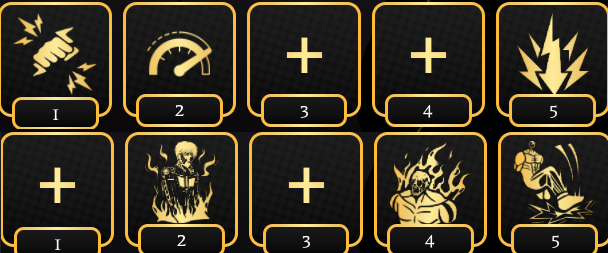

# Blood awakening Build

## SKill Layouts

## Family and SKill Tree:
- Any
- Shiki for Luck, Fritz for Extra gems

## Perks
- `Warcheif`/`Stormwrath`
- `immortal`
- `Founder's Blessing`/`Avatar of Ymir`
- `Munition masters`
### Avoid
- Adaptation
- Tatsujin
- Wings of freedom

## Artifacts
- `Colossal Scars` : `Shifter Dmg%`
- `Cloak` : `Shifter Dmg%`

## Memories
- `Blood awakening` (must)
### Optional
- Any legendary memories
- Any memories that helps with Dmg
### Avoid
- Flashsteps
