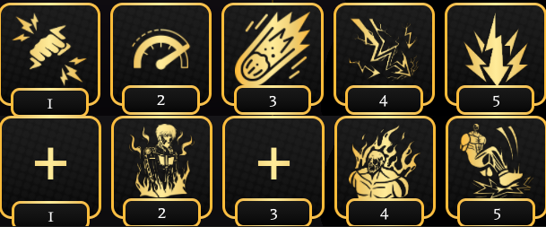

# Shiki Build

## SKill Layouts

## Family and SKill Tree:
- Shiki
- right - right - left

## Perks
- `Kengo`/`Godforged`
- `immortal`
- `Founder's Blessing`/`Avatar of Ymir`
- `Munition masters`
Note : Either `Godforged` or `Avatar of Ymir` is required
### Avoid
- Adaptation
- Tatsujin
- Wings of freedom

## Artifacts
- `Colossal Scars` : `TS Dmg%`
- `Cloak` : `TS Dmg%`

## Memories
- `Apotheosis`
- `Afterimages`
### Optional
- Any legendary memories
- Any memories that helps with Dmg
### Avoid
- Flashsteps
